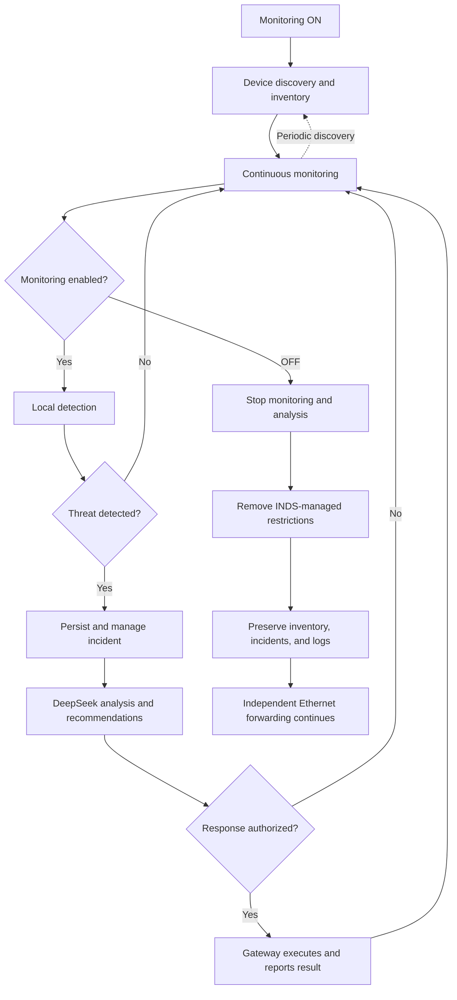

# System workflow

This is the target operating workflow. Collectors, orchestration, AI integration,
and response controls are not yet implemented.

The software ON/OFF switch is deferred until we build the internal dashboard and
monitoring services. For now, the Pi provides persistent network forwarding;
see the [current scope and follow-up work](gateway/off-contract.md).

## Operating cycle

1. **ON (internal testing only):** a developer enables monitoring; this switch is not a café-owner feature.
2. **Discover:** collect device observations and update the inventory; refresh periodically.
3. **Monitor:** collect traffic metadata continuously.
4. **Detect:** run local rules; continue monitoring when nothing suspicious is found.
5. **Analyze:** persist findings as incidents; DeepSeek assists analysis and recommends responses.
6. **Authorize:** the backend checks explicit administrator approval.
7. **Respond:** the Pi executes an authorized action, records its result, and continues monitoring.

## Data and control boundaries

- Gateway collectors provide observations; detection returns findings.
- Backend services own persistence and incident state. Other components do not open the database.
- The dashboard reads data and submits administrator commands through FastAPI.
- DeepSeek is advisory: it does not execute commands or authorize its own recommendations.
- Commit database work before network calls; record execution results separately.
- Local detection and gateway connectivity must not depend on DeepSeek availability.

**OFF stops collection, detection, AI processing, and new security responses.**
Remove INDS-managed blocks/restrictions while preserving unrelated rules and all
saved history. Prevent queued or in-flight work from applying actions after OFF;
discard late AI results. Cleanup is allowed during OFF. Report removal failures
rather than reporting successful OFF while restrictions remain. Re-enabling
monitoring must not silently reapply previous blocks without a new approval.

Linux forwarding remains operational independently of the application, database,
and DeepSeek. The Pi must stay powered and operational; physical failover is out
of scope. Detection-service failure must not stop forwarding. Automatic removal
of approved blocks on a crash, distinct from explicit OFF, requires a separate
crash-cleanup policy.

After restart, monitoring starts OFF. Reconcile unfinished runs/actions and remove
stale INDS-managed restrictions. These runtime controls are planned, not implemented.
See [OFF acceptance contract](gateway/off-contract.md) for integration acceptance checks.
