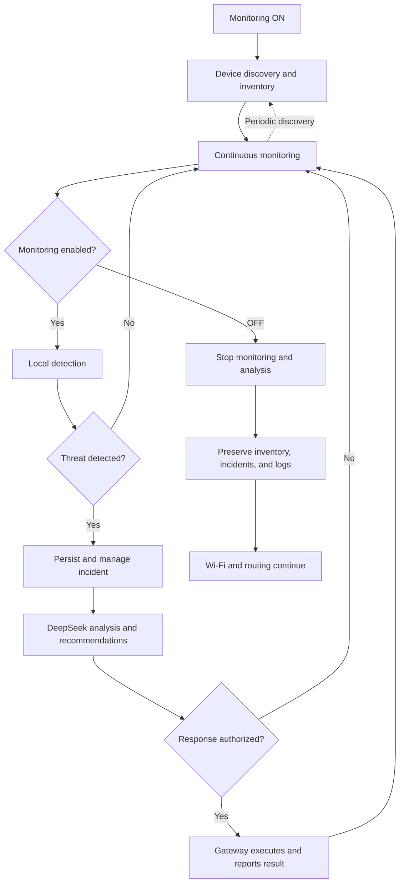

# System workflow

This is the target operating workflow. Collectors, orchestration, AI integration,
and response controls are not yet implemented.

## Operating cycle

1. **ON:** the administrator enables monitoring.
2. **Discover:** collect device observations and update the inventory; refresh periodically.
3. **Monitor:** collect traffic metadata continuously.
4. **Detect:** run local rules; continue monitoring when nothing suspicious is found.
5. **Analyze:** persist findings as incidents; DeepSeek assists analysis and recommends responses.
6. **Authorize:** the backend checks administrator approval or an explicitly approved policy.
7. **Respond:** the Pi executes an authorized action, records its result, and continues monitoring.

## Data and control boundaries

- Gateway collectors provide observations; detection returns findings.
- Backend services own persistence and incident state. Other components do not open the database.
- The dashboard reads data and submits administrator commands through FastAPI.
- DeepSeek is advisory: it does not execute commands or authorize its own recommendations.
- Commit database work before network calls; record execution results separately.
- Local detection and gateway connectivity must not depend on DeepSeek availability.

**OFF stops monitoring and analysis, not connectivity.** Preserve existing data.
Approved restrictions remain until expiry or explicit removal. Expiry/removal
must remain operational independently of monitoring. After restart, monitoring
starts OFF and unfinished runs/actions require reconciliation.
